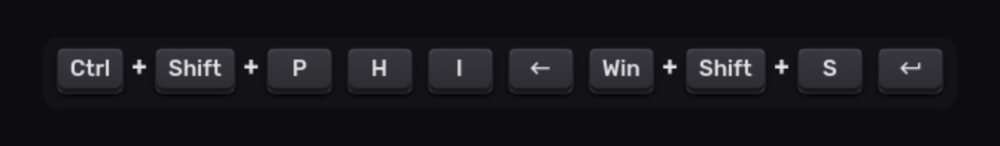

# KeyVis

A lightweight keystroke visualizer for Linux. KeyVis shows what you type as keycaps in an on-screen overlay, which makes it handy for screencasts, tutorials, and live demos. Built with GJS and GTK 4.



## Features

- **Keycaps overlay**: keystrokes appear as keys, with icons for keys like Backspace, Enter, Tab, and the arrows
- **Smart combos**: modifier combos are grouped (`Ctrl + Shift + P`), while fast typing stays as separate keys
- **Movable**: drag the overlay anywhere; the position is remembered across restarts
- **Positions**: start in any corner, edge, or the center with `--position`
- **Recording**: save keystrokes to an `.srt` subtitle file to overlay in a video editor
- **Unobtrusive**: fades out after a short pause and never steals keyboard focus

## Installation

### Prerequisites

- [GJS](https://gjs.guide/) (GObject JavaScript) runtime environment
- [GTK 4](https://archlinux.org/packages/extra/x86_64/gtk4/) library
- The [keyd](https://github.com/rvaiya/keyd) utility for capturing keyboard events (your user must be in the `keyd` group)
- [gtk4-layer-shell](https://github.com/wmww/gtk4-layer-shell) for the overlay (Hyprland, Sway, KDE, and other wlroots compositors). Without it, or on GNOME, KeyVis runs as a regular window
- A [Nerd Font](https://www.nerdfonts.com/) (e.g. `ttf-nerd-fonts-symbols`) for key icons
- [Bun](https://bun.sh/) for building the application

### Install from AUR

KeyVis is available in the Arch User Repository (AUR). You can install it using an AUR helper like yay or paru:

```sh
yay -S keyvis
```

### Manual Installation

```sh
git clone https://github.com/d7omdev/keyvis
cd keyvis
chmod +x install.sh
./install.sh
```

The script builds KeyVis, copies it to `/usr/local/lib/keyvis`, and creates the `keyvis` launcher in `/usr/local/bin`.

## Usage

```sh
keyvis
```

### Options

| Option | Alias | Description |
|---|---|---|
| `--position POS` | `-p` | Start position: `top-left`, `top`, `top-right`, `left`, `center`, `right`, `bottom-left`, `bottom`, `bottom-right` (default) |
| `--record FILE` | `-r` | Record keystrokes to an `.srt` subtitle file |
| `--kill` | `-k` | Kill all running KeyVis instances |
| `--debug` | `-d` | Print debug output |
| `--keydlog` | `-l` | Print raw keyd events (requires `--debug`) |
| `--version` | `-v` | Show version information |
| `--help` | `-h` | Show help |

### Moving the overlay

Drag the overlay while it is visible. Hovering over it keeps it on screen. The position is saved to `~/.config/keyvis/config.json` and restored on the next start.

Dragging moves the overlay away from the edges it is anchored to, so pick a corner position (the default `bottom-right`, for example) to move it freely in both directions.

### Recording keystrokes for video editing

```sh
keyvis --record keys.srt
```

Each change on screen becomes a subtitle cue, timed from the moment KeyVis started. Import the `.srt` into your video editor as a subtitle track and offset it to line up with your screen recording. Stop recording with `keyvis --kill` or `Ctrl+C`.

## Development

Common tasks are in the [justfile](./justfile):

| Command | Description |
|---|---|
| `just dev` | Build and run with debug output, rebuilding and restarting on changes in `src/` (needs [entr](https://github.com/eradman/entr)) |
| `just run` | Build and run |
| `just test` | Run the unit tests |
| `just install` | Install system-wide |
| `just uninstall` | Remove the system-wide install |

The source lives in `src/`: `keyvis.ts` is the entry point, `overlay.ts` draws the window, `keys.ts` holds the key and combo logic (covered by `keys.test.ts`), `keyd.ts` reads keyd events, `recorder.ts` writes subtitles, `placement.ts` stores the position, and `cli.ts` handles options.

## Uninstallation

```sh
./uninstall.sh
```

## Contributions

Contributions and feedback are welcome! If you encounter any issues or have suggestions for improvements, please [submit an issue](https://github.com/d7omdev/keyvis/issues) or create a pull request.

## License

This project is licensed under the [MIT License](LICENSE).
